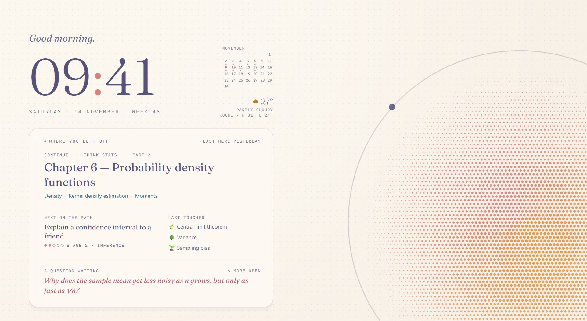

# Knowledge Bank: a paper & ink Hyprland rice

A complete desktop for CachyOS + Hyprland, designed as a personal knowledge bank: a calm, light,
paper-like place to write, keep, read and review notes.



- **Look:** warm cream paper, ink text, one rose accent (Rosé Pine Dawn). Fraunces serif for clocks and headings, IBM Plex Mono for small uppercase labels, a halftone-orb wallpaper on textured paper.
- **A desktop that remembers where you were (Quickshell):** with no windows open you see a serif clock and one paper sheet, **where you left off**: the module you're on in the course you're reading, the next milestone on your learning path, the notes you touched last, and one open question waiting for you. Click any of them to open that note in Obsidian. A small month (rose dots on study days) and the weather sit quietly beside the clock.
- **Desktop:** Hyprland (Lua config), floating-island **waybar**, **rofi** launcher, **mako** notifications, **hyprlock** lock screen that shows one of your own highlights, **hypridle**, **kitty** + **starship**.
- **Readable everywhere:** one paper & ink palette applied to GTK 3/4 apps, Qt and KDE apps (qt6ct + KDE colour scheme), the terminal's 16 colours, fish, fzf, bat and Obsidian. Every text colour is at least 3.7:1 contrast on paper.
- **Notes:** **Obsidian** and **Neovim (`kv`)** on the same Markdown vault, **zathura** for PDFs, and Super+K keys for capture, daily notes, search, review, screenshots-to-vault and focus mode.
- **Safety:** your old desktop configs are backed up (`./restore.sh` puts them back), and the vault auto-commits to git every hour.

Requires **Hyprland 0.55 or newer** (Lua config). The installer checks this.

## Install

```bash
git clone https://github.com/MrudhuhasM/knowledge-bank-rice.git
cd knowledge-bank-rice
./install.sh
```

Then **reboot**. After logging in:
- `Super + /` shows every key.
- `Super + Space` opens apps.
- `Super + K` opens the knowledge-bank keys.

First time only:
1. In Obsidian, choose **Open folder as vault** and pick `~/vault`. Then Settings → Core plugins → turn on **Templates**. The paper theme is already switched on, as the `kb-paper` CSS snippet.
2. Run `kv` once while online. It downloads its Neovim plugins.

To update later: `git pull && ./install.sh` (it updates in place and keeps your original backup).

To undo everything: `./restore.sh`, then reboot.

## Keys

| Keys | Action |
| --- | --- |
| `Super + Space` | Open an app |
| `Super + Return` | Terminal |
| `Super + Q` | Close window |
| `Super + E` | File manager |
| `Super + F` / `V` | Fullscreen / float window |
| `Super + arrows` | Move focus (add `Shift` to move the window) |
| `Super + 1…5` | Workspaces: **Write · Read · Web · Term · Misc** (add `Shift` to send a window there) |
| `Super + S` | Scratchpad |
| `Super + B` | Hide / show the bar |
| `Super + C` | Clipboard history |
| `Super + Escape` | Lock |
| `Super + Shift + E` | Power menu |
| `Print` / `Shift + Print` | Screenshot area to clipboard / full screen to file |
| `Super + /` | Cheat sheet |

**Super + K, then:**

| Key | Action |
| --- | --- |
| `C` / `P` | Capture a thought / the clipboard to Inbox |
| `D` / `Shift + D` | Today's note in Neovim / Obsidian |
| `N` / `Shift + N` | New note / new source (book, article, paper) |
| `G` | Screenshot an area into the vault; copies `![[file]]` to paste |
| `S` | Search all notes |
| `R` | Review session (`#review`-tagged and forgotten notes) |
| `O` / `V` | Obsidian / vault in Neovim |
| `I` / `H` | Inbox / Home |
| `F` | Focus mode: no gaps, rounding, blur or animations; bar hidden; notifications paused |

Obsidian opens on workspace 1 (Write), PDFs on 2 (Read), browsers on 3 (Web).

**Inside `kv` (Space is the leader key):**
- `d` today, `y` yesterday, `n` new note
- `f` find a note, `s` search
- `b` backlinks, `l` links, `t` tags
- `T` insert a template, `x` toggle a checkbox
- `i` Inbox, `h` Home
- `z` zen mode, `o` open in Obsidian, `ub` switch light/dark

**In zathura:** `C` sends the selected text to Inbox. `Ctrl+R` switches to dark mode for night reading.

**Bar:** click the book icon for today's note, right-click to start a review, middle-click to capture.

## Vault layout

```
~/vault
├── Home.md        index + how the system works
├── Inbox.md       quick captures
├── Daily/         one note per day
├── Notes/         permanent notes
├── Sources/       books, articles, papers, videos
├── Attachments/   images, screenshots, PDFs
└── Templates/     daily.md, note.md, source.md
```

Lines starting with `> ` (highlights) appear on the lock screen at random.

## The desktop

**Where you left off** is read from your vault by `kb-resume` every two minutes (it only reads, never writes). It understands these conventions, and simply leaves out what your vault doesn't have:

| Shows | Comes from |
| --- | --- |
| Continue … the next module | the newest note with `type: source` and `status: reading`: its first unticked `- [ ]` line under `## Contents`, plus the `[[concepts]]` linked on that line |
| Next on the path | the newest note with `type: track` and `status: active`: its first unticked milestone under `## Milestones` and the `### stage` it sits in (dots = stage progress) |
| Last touched | the three notes you changed most recently (from git history when the vault is a git repo); 🌱 🌿 🌳 for `status: seed / growing / solid` |
| A question waiting | the newest `- [ ] … #question` that isn't marked "(answered …)"; otherwise the oldest seed concept to grow |
| Study days in the month | days on which any note changed or a `Journal/YYYY-MM-DD` log exists |

Using an existing vault: point `VAULT=` in `~/.config/kb/config` at it (for example a git clone of your notes) and Obsidian should have it open under the same folder name. Run `kb-resume` in a terminal to see what it finds.

- **Weather** comes from [wttr.in](https://wttr.in). Set your city in `~/.config/kb/config`: `KB_WEATHER_LOCATION="Kochi"` (empty = guess from your IP) and `KB_WEATHER_UNITS="c"` or `"f"`. Click it to refresh.
- The lock screen still shows a random highlight: any line starting with `> ` in your notes.
- Restart the desktop after changing settings: `pkill quickshell; quickshell -c kb &`
- Edit them in `~/.config/quickshell/kb/shell.qml`. Quickshell reloads live as you save.

## Customising

- **Your own Hyprland tweaks:** create `~/.config/hypr/user.lua`. It loads last and updates never overwrite it.
- **Colours:** the palette is at the top of `~/.config/hypr/hyprland.lua` and in `~/.config/waybar/style.css`.
- **Vault location:** set it before installing with `KB_VAULT=~/notes ./install.sh`, or edit `~/.config/kb/config`.
- **Sync notes to another device:** use a **private** git remote for `~/vault` (`kb-sync` pushes hourly), or Syncthing. Never put notes in this public repo.
